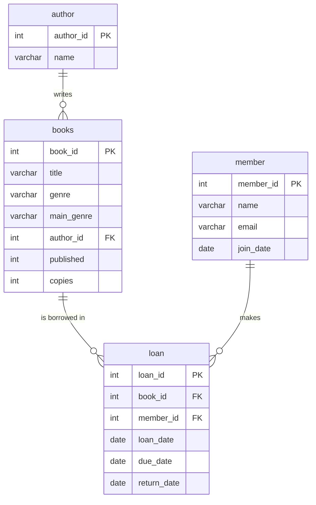

# 🗄️ SQL Projects

Beginner-friendly SQL projects built with **MySQL** while learning to work with data. Each project has its own folder with the schema, sample data and the queries I wrote to answer real questions.


---

## 📚 Project 1: Library Database

A small library management database that tracks authors, books, members and book loans. It is built to practice designing tables and answering questions with queries.

### 🧩 Database design



| Table | What it stores | Rows |
|---|---|---|
| `author` | Book authors | 18 |
| `books` | Books, their genre, year and number of copies | 19 |
| `member` | Library members | 12 |
| `loan` | Every borrowing: who took which book, due date, return date | 20 |

A `NULL` in `loan.return_date` means the book has not been returned yet.

### 🛠️ Skills practiced

- `CREATE TABLE`, primary keys and foreign keys
- `INSERT`, `UPDATE`, `ALTER TABLE`
- `JOIN` and `LEFT JOIN` across multiple tables
- `GROUP BY`, `HAVING` and aggregate functions (`COUNT`, `AVG`)
- Date functions (`CURDATE`, `DATEDIFF`)
- Filtering with `WHERE`, `IS NULL`, `ORDER BY`, `LIMIT`

### ❓ Questions answered

1. Which books are overdue?
2. Who are the top 5 borrowers?
3. Which members have never borrowed a book?
4. Which authors have more than one book?
5. How many books are in each genre?
6. What is the average number of days a book is kept?

### 🔍 Sample queries

**Overdue books (not returned and past the due date)**

```sql
SELECT member.name, books.title, loan.due_date
FROM loan
JOIN member ON loan.member_id = member.member_id
JOIN books  ON loan.book_id   = books.book_id
WHERE loan.return_date IS NULL
  AND loan.due_date < CURDATE();
```

**Members who never borrowed a book**

```sql
SELECT m.member_id, m.name
FROM member AS m
LEFT JOIN loan AS l ON m.member_id = l.member_id
WHERE l.loan_id IS NULL;
```

**Average days a book is kept**

```sql
SELECT ROUND(AVG(DATEDIFF(return_date, loan_date)), 2) AS average_days_kept
FROM loan
WHERE return_date IS NOT NULL;
```

### ▶️ How to run it

1. Open **MySQL Workbench** and connect to your local server.
2. Create the database:
   ```sql
   CREATE DATABASE bookstore;
   USE bookstore;
   ```
3. Run [`library-database/bookstore.sql`](library-database/bookstore.sql) to create the tables and insert the data.
4. Run [`library-database/queries.sql`](library-database/queries.sql) to see the queries in action.

---

## 📁 Repository structure

```
SQL-Projects/
├── README.md
└── library-database/
    ├── bookstore.sql    # tables + sample data
    └── queries.sql      # all the queries
```

## 🚀 What's next

- [ ] Sales analysis on a public dataset
- [ ] IPL cricket stats with window functions
- [ ] Movie ratings analysis

---

## 👋 About me

I'm **Tushar Kushwaha**, a BSc (Physical Science with Computer Science) student at Deshbandhu College, Delhi. I'm learning Python, SQL and data analysis, and I also build 3D web projects.

- GitHub: [@tushar-kushwaha](https://github.com/tushar-kushwaha)
- LinkedIn: [tushar-kushwaha](https://www.linkedin.com/in/tushar-kushwaha-263256435)

⭐ If you found this useful, feel free to star the repo!